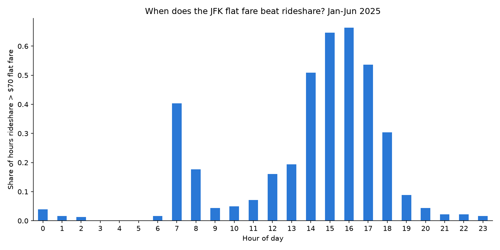
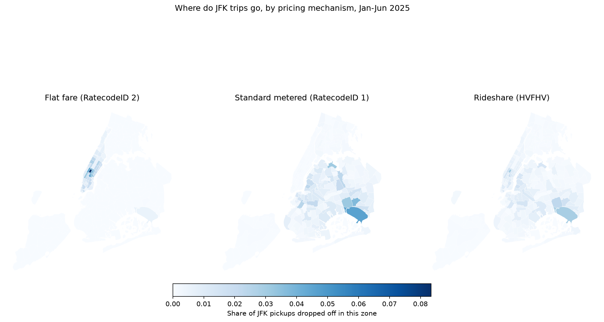

# When Regulation Beats the Algorithm: JFK Flat Fare vs Rideshare Surge

**Question:** When does a yellow taxi's regulated $70 JFK flat fare beat surge-priced rideshare, and what should taxi drivers do with that?

**Data:** 2.5M+ JFK trips from NYC TLC (yellow taxi and rideshare, Jan to Jun 2025), joined with US BTS flight arrival data.
**Tools:** PySpark, pandas, GeoPandas, scikit-learn, LaTeX.



## Key findings

- **The flat fare doesn't move. Rideshare does.** The flat fare's coefficient of variation is 0.0015, against 0.53 for rideshare. Rideshare price tracks flight arrivals (r = 0.54). The flat fare doesn't (r = 0.02).
- **Mid afternoon is when the taxi wins.** Rideshare costs more than $70 in about two thirds of hours between 3pm and 5pm. Overnight it almost never does (under 5% of hours from 11pm to 6am).
- **Flat fare trips go to Manhattan.** 98.9% of flat fare trips end in Manhattan, while metered trips mostly go to Queens (52%) and Brooklyn (41%).
- **A simple model is enough.** Linear regression (MAE $6.61, R² 0.58) slightly beat a random forest (MAE $7.01, R² 0.53) on a May to June holdout. Time of day and flight volume explain most of what's predictable.

## Recommendations for drivers

1. **Queue at JFK in the 2pm to 6pm window**, not "during the day" in general. That's when rideshare is most likely to be pricier than the taxi.
2. **After a flat fare run, work Manhattan instead of driving straight back to the airport.** You're dropped in Midtown at exactly the hours when rideshare is most likely to be overpriced.

## Method

| Step | Notebook |
|---|---|
| Spark session, schema checks, validity filtering | [`02_preprocessing`](notebooks/02_preprocessing.ipynb) |
| Fare variance and demand responsiveness | [`03_analysis`](notebooks/03_analysis.ipynb) |
| Zone and borough destination mapping | [`04_geospatial`](notebooks/04_geospatial.ipynb) |
| Linear regression vs random forest | [`05_modelling`](notebooks/05_modelling.ipynb) |

- **Temporal split:** train on Jan to Apr 2025, test on May to Jun 2025. No random shuffling, so the model never sees the future.
- **External data:** BTS on-time performance, filtered to JFK arrivals, used as the demand signal.
- The full write-up is in [`report/main.tex`](report/main.tex).



## Data

| Dataset | Source |
|---|---|
| Yellow taxi trip records, Jan to Jun 2025 | NYC TLC |
| High Volume For-Hire Vehicle (rideshare) records, Jan to Jun 2025 | NYC TLC |
| Taxi zone lookup and shapefile | NYC TLC |
| Airline On-Time Performance (JFK arrivals) | US Bureau of Transportation Statistics |

All data is public. `python scripts/download_data.py` fetches everything into `data/` (gitignored, nothing raw is committed).

## Run it

```bash
python3 -m venv .venv
source .venv/bin/activate
pip install -r requirements.txt
python scripts/download_data.py
```

Needs a JDK for PySpark (built against OpenJDK 17). Run the notebooks in order, 02 to 05.

## Limitations

- Neither dataset has a driver or vehicle ID, so I can't follow what an individual driver actually did next.
- Both models under-predict the highest daily peaks, so the "rideshare beats $70" estimates are conservative.

---

*Originally built as an individual project for MAST30034 Applied Data Science, University of Melbourne (2026).*
